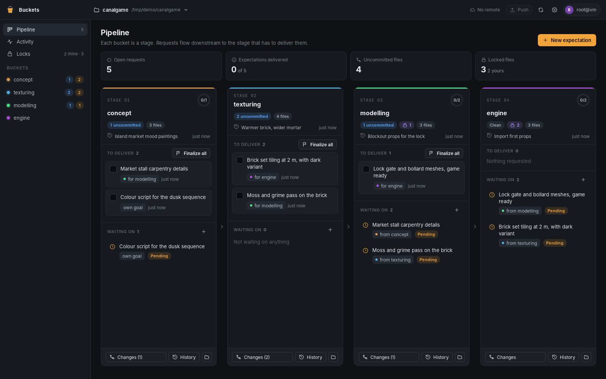
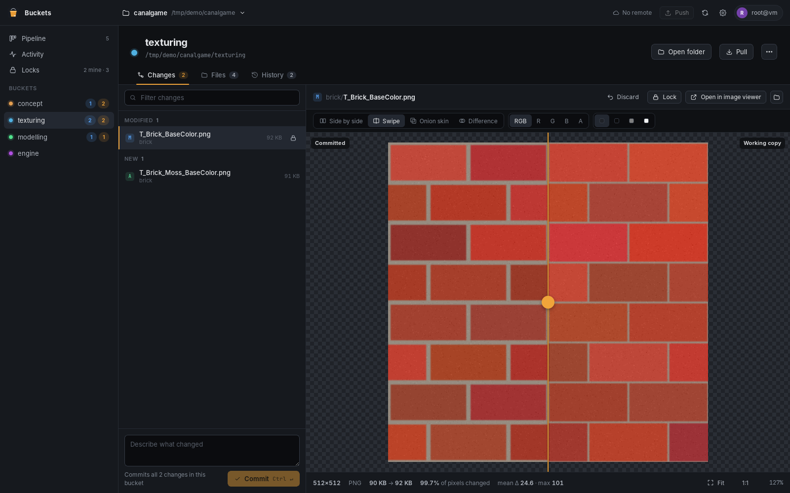

# Buckets desktop

A desktop app for buckets, made for artists as much as for programmers. It shows
the production pipeline as a board, compares textures visually, and makes file
locks visible and easy to take.



## What it does

**Pipeline board.** Every bucket is a stage, ordered so that a stage comes
after the stages it expects work from. Each stage shows:

- what it has to deliver to others (pebbles), with a tick box per request and
  **Finalize** for the selected ones (or all of them);
- what it is waiting on (expectations), marked Pending, Delivered or Met;
- uncommitted files, locks and the last commit.

**New expectation** opens a dialog with "Delivered by → Needed by" and a
description, the same as `buckets expect "…" --from A --in-bucket B`.

**Changes.** The files that differ from the last commit, grouped as Modified,
New and Deleted, with a commit box underneath (Ctrl+Enter commits). If a
changed file is locked by someone else the app says so before you try.

**Visual diffs.** Select a texture to compare the committed version with the
working copy:

- side by side, swipe (drag the handle), onion skin (opacity slider) and a
  difference heat map, with the share of changed pixels and mean/max change;
- R, G, B and A channel isolation (alpha shows as greyscale);
- checker, black, grey or white background;
- wheel to zoom around the cursor, drag to pan, double-click or F to fit,
  0 for 1:1. Views stay in sync in side-by-side mode.

PNG, JPEG, TGA, TIFF, BMP, WebP, GIF, EXR and HDR are decoded (HDR is clamped
to 0–1 for display, 16-bit shown at 8-bit). `.blend` files show the thumbnail
Blender saves inside them, including compressed files. Text files (configs,
scripts, `.usda`, Markdown) get a line diff. Other files show size and hash
before and after, plus **Open in Blender / Houdini / Unreal Editor** (the
default app for the file) and **Show in folder**.



**History.** Commits newest first with +added ~modified −deleted counts, the
files each commit changed, and the same viewer between a commit and the one
before it. **Restore this version** puts an old version back in the working
folder (`buckets revert <file> --commit <id>`).

**Files and locks.** The Files tab lists every file by folder, with filters for
scenes (Blender, Houdini, Unreal, Substance), images, locked and mine. Lock or
unlock one file from its row, or tick several and lock them together. The
**Locks** page lists every lock in the repository with who holds it and since
when; breaking someone else's lock asks first.

**Activity.** Every commit across the pipeline by day; click one to open it.

**Sync.** Push copies committed objects to the remote store (a NAS folder, set
in Settings). Pull in a bucket fetches and updates its working files; "Pull,
overwriting local edits" and stash/restore are in the bucket's ⋯ menu.

The app refreshes when its window gets focus (after you save in another app)
and every 20 seconds while visible. Dark and light themes; dark is the default.

### Keyboard

| Key | Action |
| --- | --- |
| Ctrl+Enter | Commit (in the message box), confirm a dialog |
| Ctrl+R | Refresh |
| `/` | Filter the file list |
| ↑ ↓ or J K | Next / previous file |
| 1 2 3 4 | Side by side, swipe, onion skin, difference |
| C R G B A | Colour or a single channel |
| F, 0 | Fit, actual size |

## How it is built

- `src-tauri/`: a [Tauri 2](https://tauri.app) app in Rust.
  - Reads go through the **buckets library** (`buckets` crate): the same
    database connection, manifests, stat-cached scanner, object store and lock
    table that the CLI uses.
  - Changes (commit, lock, unlock, finalize, expect, revert, stash, push, pull,
    remote set) run the **buckets CLI** with `--json`. Those commands live in
    the CLI binary and carry the safety rules (lock checks, transactions,
    atomic writes), so the app can never disagree with the CLI.
- `ui/`: plain HTML, CSS and JavaScript modules, no build step.

One window works on one repository, because the library keeps one global
database connection. Opening another repository restarts the app on it.

## Run it

Linux needs WebKitGTK:

```bash
sudo apt install libwebkit2gtk-4.1-dev libgtk-3-dev librsvg2-dev libssl-dev
```

macOS needs nothing extra. Windows needs WebView2 (already on Windows 11).

The `buckets` CLI must be installed (on PATH, in `~/.cargo/bin`, next to the
app, or set in Settings), and the database reachable the usual way
(`DATABASE_URL`, the repository's `db_config.toml`, or `buckets setup`).

```bash
cd buckets-desktop/src-tauri
cargo run -- /path/to/repo        # or set BUCKETS_REPO, or pick it in the app
```

Packages (`.deb` and AppImage on Linux, `.dmg` on macOS, installer on
Windows):

```bash
cargo install tauri-cli --version "^2" --locked
cargo tauri build
```

The app lives outside the root Cargo workspace on purpose, so building the CLI
does not need WebKitGTK.

### Settings

Stored in `~/.config/buckets-desktop/settings.json` (platform config folder
elsewhere): recent repositories, CLI path, theme, and whether to run the
semantic duplicate check when adding expectations (off by default, because the
first run downloads a 90 MB model). Locks are taken as `BUCKETS_USER` if set,
otherwise `user@host`, like the CLI.

## Try it with a demo repository

```bash
python3 scripts/make_demo_repo.py /tmp/demo   # needs Pillow and a database
cargo run --manifest-path src-tauri/Cargo.toml -- /tmp/demo/canalgame
```

It creates four stages (concept, texturing, modelling, engine) with textures,
expectations between them, a few locks (one held by "maya@studio-pc") and
uncommitted edits.

## Tests

```bash
cd src-tauri && cargo test       # unit tests: diffs, .blend thumbnails, CLI errors
```

`tests/e2e.py` drives the real app through `tauri-driver` on Linux: it commits,
compares textures in every mode, locks a file, finalizes a request, adds an
expectation, pushes to a remote and switches themes, saving a screenshot of
each step. Setup is in the file's header.

## Known limits

- Commit records every change in the bucket; the CLI has no partial commits.
- Finalize marks an expectation as met only when it was the stage's own goal.
  For requests from another stage the app shows the expectation as
  **Delivered** once all its requests are finalized.
- No previews for PSD, `.uasset`/`.umap` or Houdini files yet.
- Built and tested on Linux. macOS and Windows build in principle but have not
  been tried.
